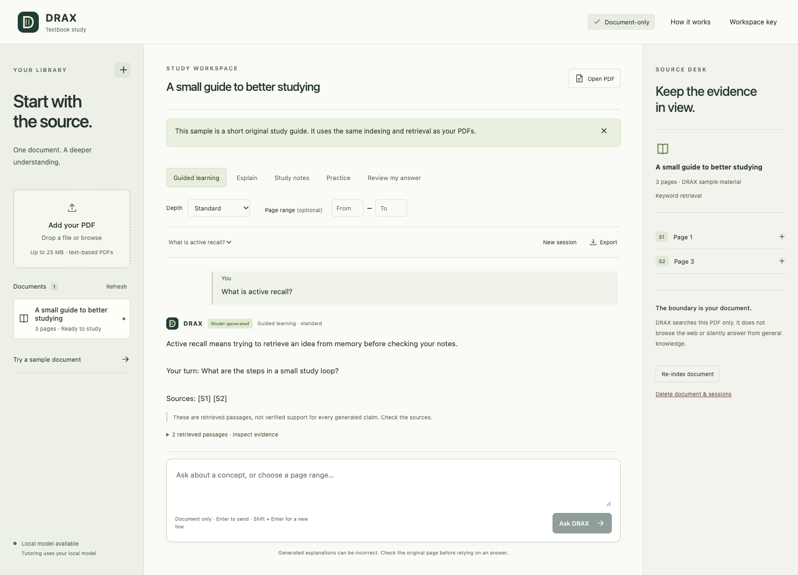
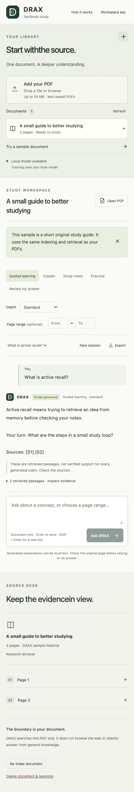
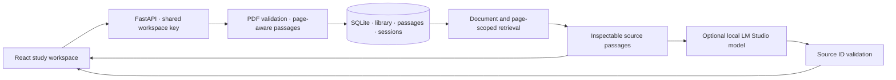

# DRAX TBS

**A document-only study workspace. Learn from the source, then check the page.**

DRAX turns a text-based PDF into a personal study space: guided learning, layered explanations, study notes, practice questions, and feedback on your own answer. A source desk keeps retrieved passages visible beside the conversation. Every passage retains its actual PDF page number.



## What changed in v2

- Five distinct learning modes, with overview, standard, and deep-dive settings.
- Document-scoped retrieval and optional page ranges. No general-knowledge fallback or web browsing.
- Actual page references, expandable evidence cards, and an original-PDF viewer.
- Persisted study sessions, session switching, and Markdown exports with source passages.
- A real sample PDF for exploring the workflow without downloading an AI model.
- Upload validation, size/page limits, scanned-page guidance, and atomic re-indexing.
- A calm, responsive interface with keyboard controls, reduced-motion support, and native modal dialogs.
- Lightweight keyword retrieval by default; neural retrieval is an explicit optional installation.

## Run locally

Use **Python 3.11+** and **Node.js 22.12+**.

```sh
git clone https://github.com/nymav/drax_tbs.git
cd drax_tbs
python3 -m venv .venv
source .venv/bin/activate
pip install -r backend/requirements.lock
cp backend/.env.example backend/.env
PYTHONPATH=backend uvicorn app.main:app --host 127.0.0.1 --port 8007
```

In a second terminal:

```sh
cd drax_tbs/frontend
npm ci
npm run dev
```

Open [localhost:5177](http://localhost:5177). On Windows, activate `.venv\Scripts\activate` and set `$env:PYTHONPATH="backend"` in PowerShell before starting the backend.

The locked Python environment includes test tools. For a lean runtime installation, use `backend/requirements.txt`; its version ranges are less reproducible than the lock file.

### Without a model

Upload a PDF or choose **Try a sample document**. DRAX indexes the actual text and returns real source passages. The interface labels this **Source passages**, not AI tutoring. Out-of-document questions return **No match** without a model call.

### With LM Studio

1. Load a chat/instruction model in LM Studio and start its local OpenAI-compatible server.
2. The model must support [LM Studio’s JSON Schema output](https://lmstudio.ai/docs/developer/openai-compat/structured-output). Keep the model server local; the default endpoint is `http://127.0.0.1:1234/v1/chat/completions`.
3. Set `LMSTUDIO_MODEL` in `backend/.env`, or leave it blank to discover the first available model.
4. Restart the backend, then refresh the workspace.

DRAX accepts a loopback HTTP model endpoint only. It does not silently switch to a cloud provider. A connection failure, timeout, truncated response, or invalid source references produces a visible source-only result.

## Learning layers

| Mode | Purpose |
| --- | --- |
| Guided learning | Explain a step and ask the learner to reason about the next one |
| Explain | Define a concept, unpack its mechanism, and use document-supported examples |
| Study notes | Condense retrieved passages while preserving qualifications |
| Practice | Generate questions with a separately revealable answer key |
| Review my answer | Compare the learner’s explanation against retrieved passages |

Depth changes the explanation instructions and output budget. It does not improve retrieval accuracy by itself.

Ask using terms from the document. A page range restricts search to those pages. Overview/practice requests intentionally use the first six passages in scope: they are **not a full-book analysis**. Generated responses include `[S1]` references matching the retrieved cards; these checks validate source IDs, not whether every claim is supported.

## Optional neural retrieval

```sh
pip install -r backend/requirements-semantic.txt
```

Set `DRAX_RETRIEVAL=semantic` and restart. Re-index each PDF using **Index document** before querying it. The first indexing operation downloads the configured sentence-transformer model; subsequent inference is local. Switching models requires re-indexing. The default model is `all-MiniLM-L6-v2`.

This is exact cosine search over a small personal library, not a large-scale vector service. The similarity cutoff is a heuristic, not an evaluated accuracy guarantee. Neural dependencies and live neural quality have not been validated in the core preview.

## Storage and privacy

- PDFs, extracted passages, optional vectors, and study sessions are stored on the backend machine under `backend/.drax-data/` by default. Set `DRAX_DATA_DIR` to change the location.
- Local generation sends the learner’s question and retrieved passages to the configured local model. There are no analytics, external fonts, or remote AI fallback in the app.
- A remotely hosted backend receives and stores uploaded documents. **This is not a browser-only PDF tool.**
- All users of one workspace share its library. There are no separate accounts or per-user isolation.
- Deleting a document removes its active file, index, and sessions. This is not forensic secure erasure; backups and SQLite free pages may retain data.

The v2 commit stops tracking uploaded books, generated indexes, and `node_modules`. Existing local legacy files are preserved. Previously committed files remain in Git history; this change does not erase historical data.

### Existing v1 documents

The new workspace does not automatically open old `backend/data` files. To import your own legacy PDFs explicitly, start the backend and run:

```sh
python scripts/import_legacy.py backend/data/pdfs
```

This copies each PDF through the new upload/indexing flow. Originals remain unchanged; old conversations and Chroma indexes are not migrated. Re-running imports creates additional copies.

## Configuration

See [backend/.env.example](backend/.env.example) and [frontend/.env.example](frontend/.env.example).

| Variable | Default / purpose |
| --- | --- |
| `DRAX_DATA_DIR` | Private runtime directory, independent of working directory |
| `DRAX_MAX_FILE_MB` / `DRAX_MAX_PAGES` | 25 MB / 600 pages |
| `DRAX_RETRIEVAL` | `lexical`; optional `semantic` |
| `DRAX_EMBEDDING_MODEL` | Local sentence-transformer model for optional neural retrieval |
| `LMSTUDIO_API` / `LMSTUDIO_MODEL` | Local model endpoint and selected model |
| `DRAX_API_KEY` | Shared workspace key; required for network access |
| `DRAX_CORS_ORIGINS` | Explicit allowed frontend origins |
| `VITE_API_URL` | `/api` through the dev proxy; set a backend `/api` URL for separate hosting |

For network hosting, use TLS, an explicit workspace key, restrictive CORS, and a reverse proxy with upload limits. Do not expose the model server publicly. The key is entered through **Workspace key** and stays in tab memory. GitHub Pages can host only the frontend; the Python API needs a server and persistent storage.

## Validation

```sh
pytest -q
ruff check backend/app backend/tests scripts
cd frontend
npm test
npm run build
```

Regression tests cover real page provenance, document-only abstention, distinct prompts, invalid citations, session/document boundaries, upload limits, atomic indexing, access keys, and cascading deletion. Browser checks cover the sample, saved sessions, export, PDF/help dialogs, unmatched questions, and mobile overflow. See [validation notes](docs/validation.md) for scope and limitations.

Generated explanations can still hallucinate or misinterpret a real passage. Prompt instructions and source-ID validation do not solve semantic correctness or prompt injection. Scanned PDFs need OCR before upload; tables, equations, and complex layouts may extract poorly. Stop waiting cancels the browser request, not an already-running model operation; reopen the session to check whether it completed.

<details><summary>Mobile workspace</summary>



</details>

## Architecture



Built by [Nikhil Yarra](https://github.com/nymav).
